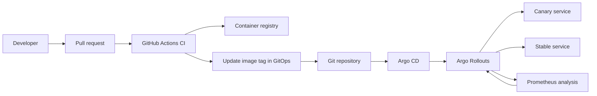

# GitOps Progressive Delivery Platform

A production-shaped DevOps reference project for continuous delivery with:

- GitHub Actions CI: test, build, scan, and publish an immutable container image
- GitOps CD: Argo CD watches the `environments` directory
- Progressive delivery: Argo Rollouts performs a canary release
- Automated verification: Prometheus metrics decide whether the canary advances
- Kubernetes-native operations: probes, resource limits, security context, and rollback hooks
- Tutorial-aligned Jenkins, SonarQube, Trivy, Terraform, EKS, Helm, and Argo CD automation

## Architecture



## Repository layout

```text
app/                         Demo service and tests
docker/                      Container build files
k8s/base/                    Shared Kubernetes resources
k8s/environments/dev/        Development GitOps overlay
k8s/argocd/                  Argo CD Application
.github/workflows/           CI and GitOps automation
scripts/                     Local validation helpers
terraform/                   AWS Jenkins/SonarQube host infrastructure
docs/                        Tutorial-to-project mapping
```

## Prerequisites

- Docker
- kubectl
- A Kubernetes cluster with Argo CD, Argo Rollouts, and Prometheus
- A container registry, such as GHCR
- GitHub repository Actions permissions to write packages and push commits

## Local run

```powershell
node app/server.js
Invoke-WebRequest http://localhost:8080/healthz
```

Run tests:

```powershell
npm test
```

Build the image:

```powershell
docker build -f docker/Dockerfile -t gitops-demo:local .
docker run --rm -p 8080:8080 gitops-demo:local
```

## Cluster bootstrap

1. Install Argo CD, Argo Rollouts, and kube-prometheus-stack in the target cluster.
2. Replace `YOUR_GITHUB_ORG/YOUR_REPOSITORY` in `k8s/argocd/application.yaml`.
3. Apply the Argo CD Application:

```powershell
kubectl apply -f k8s/argocd/application.yaml
```

4. Confirm the `prometheus` service is available in the `monitoring` namespace. The analysis template expects the in-cluster DNS name `kube-prometheus-stack-prometheus.monitoring.svc.cluster.local`.
5. Configure the GitHub Actions variables `IMAGE_NAME` and `GITOPS_PATH` if you want values different from the defaults.

The first deployment starts at 10% canary traffic, pauses for two minutes, runs the Prometheus analysis, and then advances through 25%, 50%, and 100%. Any failed measurement automatically aborts and returns traffic to the stable ReplicaSet.

## Tutorial execution order

For the full AWS workflow shown in the tutorial, follow [docs/tutorial-mapping.md](docs/tutorial-mapping.md):

1. Copy `terraform/terraform.tfvars.example` to `terraform/terraform.tfvars`, replace the AMI and key pair, and run `terraform init` then `terraform apply`.
2. Open Jenkins on port `8080`, install the Docker Pipeline, SonarQube Scanner, and Kubernetes-related plugins, then add the credentials referenced by `Jenkinsfile`.
3. Create the EKS cluster with `scripts/create-eks.ps1`.
4. Install Prometheus/Grafana and Argo Rollouts with `scripts/install-platform.ps1`.
5. Replace the Git URL in [application.yaml](k8s/argocd/application.yaml) and apply it to Argo CD.

AWS resources can incur charges. The infrastructure steps are intentionally not run automatically.

## Release flow

- Pull requests run tests, build the image, and scan the filesystem with Trivy.
- A merge to `main` publishes an image tagged with the commit SHA.
- The workflow updates `k8s/environments/dev/kustomization.yaml` with that immutable tag.
- Argo CD detects the Git commit and syncs the desired state.
- Argo Rollouts controls traffic shifting and verification.

## Safety notes

- The demo uses a `Service` selector managed by Argo Rollouts; do not replace it with a normal Deployment selector.
- In production, use a private registry, workload identity, signed images, network policies, and an external secret manager.
- The workflow deliberately fails on test, image build, or vulnerability scan errors before GitOps promotion.
